<p align="center">
  
</p>

# memorable-mcp

[](https://github.com/leouofa/memorable-mcp/releases/tag/v1.0.0)
[](https://modelcontextprotocol.io)
[](https://www.typescriptlang.org)
[](https://nodejs.org)
[](https://github.com/leouofa/memorable)
[](https://github.com/pgvector/pgvector)
[](LICENSE)

Official TypeScript-based [Model Context Protocol (MCP)](https://modelcontextprotocol.io/) server for [Memorable](https://github.com/leouofa/memorable), the local-first AI memory management studio and developer workbench.

This server enables AI assistants and autonomous agents (Antigravity, Claude Desktop, Cursor, and custom MCP clients) to seamlessly query, author, recall, and vectorize persistent context, architectural guidelines, user preferences, and memories through the Memorable REST API and pgvector semantic engine.

---

## Features

- **Full MCP Capabilities Suite**:
  - **17 Comprehensive Tools**:
    - **Vector & Semantic Search**: Unified `pgvector` semantic search (`memorable_search`), nearest neighbor discovery (`memorable_find_neighbors`), and on-demand vectorization (`memorable_generate_embedding`).
    - **Composite Context Recall**: `memorable_recall_context` retrieves all standing pinned memories and executes semantic search in parallel, returning deduplicated, ranked context in one call.
    - **Memory Lifecycle**: Full CRUD (`memorable_list_memories`, `memorable_get_memory`, `memorable_create_memory`, `memorable_update_memory`, `memorable_delete_memory`).
    - **Safe Appending**: Append Markdown updates and logs without overwriting prior body (`memorable_append_to_memory`).
    - **Workspace Curation**: Pin toggle (`memorable_toggle_pin`) and pinned reordering (`memorable_reorder_pinned`).
    - **Context Files**: File attachments with multipart upload from disk or base64 (`memorable_list_attachments`, `memorable_upload_attachment`, `memorable_delete_attachment`).
    - **Markdown & System**: Redcarpet GFM rendering (`memorable_render_markdown`) and workbench metrics (`memorable_get_stats`).
  - **5 MCP Resources**: Direct URI inspection via:
    - `memorable://stats`: Workbench counts (memories, pinned memories, attachments).
    - `memorable://memories`: Index list of all active memories.
    - `memorable://memories/pinned`: Combined Markdown document of all pinned memories for instant standing instruction loading.
    - `memorable://memories/{id}`: Full memory Markdown body with YAML metadata frontmatter.
    - `memorable://memories/{id}/neighbors`: JSON nearest semantic neighbor memories with cosine similarity scores.
  - **Context Recall & Dynamic Prompts**:
    - `memorable_recall_context`: Synthesizes pinned context and semantic search matches into an executive context brief.
    - `memorable_author_memory`: Interactive engineering guide to draft structured technical memories and ADRs.
    - `memorable_use_memory_template`: Executes `{{variable}}` templates from memory bodies.
    - **Dynamic Memory Prompts (`memorable_<id>_<slug>`)**: On startup, saved memories with `{{variables}}` are automatically discovered and exposed as typed native MCP prompts.
- **Stdio Transport**: Low-latency JSON-RPC 2.0 communication over standard input/output.
- **OpenAPI 3.1 Contract**: Strongly typed client generated directly against Memorable's OpenAPI 3.1.0 specification with runtime `Zod` validation.
- **Zero Friction Setup**: Works out of the box with your local Memorable Rails server (`http://localhost:3000`).

---

## Architecture Overview

```mermaid
flowchart LR
    Client["AI Agent / Desktop Client<br/>(Antigravity, Claude, Cursor)"]
    Stdio["Stdio Transport<br/>(JSON-RPC 2.0)"]
    MCPServer["Memorable MCP Server<br/>(@modelcontextprotocol/sdk)"]
    APIClient["Typed MemorableClient<br/>(Node native fetch)"]
    MemorableAPI["Memorable Rails 8.1 API<br/>(http://localhost:3000/api/v1)"]
    PGVector[("PostgreSQL + pgvector<br/>(1024-dim HNSW + Ollama)")]

    Client <-->|MCP Protocol| Stdio
    Stdio <--> MCPServer
    MCPServer -->|17 Tools / 5 Resources / Prompts| APIClient
    APIClient <-->|REST JSON & Multipart| MemorableAPI
    MemorableAPI <--> PGVector
```



---

## Quickstart

### Prerequisites

- **Node.js**: `v18.0.0` or higher (recommended: Node 20+)
- **Memorable**: Running locally (default: `http://localhost:3000`)
- **Ollama**: Running locally with `qwen3-embedding:0.6b` (for vector embeddings)

### Installation & Build

```bash
# Clone repository
git clone https://github.com/leouofa/memorable-mcp.git
cd memorable-mcp

# Install dependencies
npm install

# Build the TypeScript distribution
npm run build
```

---

## Configuration

The server can be configured via environment variables or command-line arguments:

| Option | Environment Variable | CLI Flag | Default | Description |
| :--- | :--- | :--- | :--- | :--- |
| **API URL** | `MEMORABLE_API_URL` | `-u, --url <url>` | `http://localhost:3000` | Memorable API base URL |
| **API Key** | `MEMORABLE_API_KEY` | `-k, --api-key <key>` | *(none)* | Optional Bearer token for authentication |
| **Timeout** | `MEMORABLE_TIMEOUT_MS` | `-t, --timeout <ms>` | `30000` | HTTP request timeout in milliseconds |
| **Memory Sync** | — | `--no-sync` | `true` | Eagerly register saved Memorable memories as prompts at startup |

---

## Client Integration Guides

### 1. Antigravity IDE

Add to your local MCP server configuration in Antigravity (`~/.gemini/antigravity/mcp_config.json` or project settings):

```json
{
  "mcpServers": {
    "memorable": {
      "command": "node",
      "args": ["/Users/leonid/src/memorable-mcp/dist/index.js"],
      "env": {
        "MEMORABLE_API_URL": "http://localhost:3000"
      }
    }
  }
}
```

### 2. Claude Desktop

Add `memorable` to your `claude_desktop_config.json` (`~/Library/Application Support/Claude/claude_desktop_config.json` on macOS):

```json
{
  "mcpServers": {
    "memorable": {
      "command": "node",
      "args": ["/absolute/path/to/memorable-mcp/dist/index.js"],
      "env": {
        "MEMORABLE_API_URL": "http://localhost:3000"
      }
    }
  }
}
```

### 3. Cursor

Add to your `.cursor/mcp.json`:

```json
{
  "mcpServers": {
    "memorable": {
      "command": "node",
      "args": ["/absolute/path/to/memorable-mcp/dist/index.js"],
      "env": {
        "MEMORABLE_API_URL": "http://localhost:3000"
      }
    }
  }
}
```

---

## Available MCP Primitives

### MCP Tools (17)

| Tool | Description | Key Parameters |
| :--- | :--- | :--- |
| `memorable_search` | Unified pgvector semantic & keyword search | `q` (query), `mode` (`auto`, `semantic`, `keyword`), `limit` |
| `memorable_recall_context` | Composite retrieval: pinned memories + semantic matches | `query` (optional), `mode`, `limit`, `include_pinned` |
| `memorable_list_memories` | List and filter memories across the workspace | `q`, `mode`, `pinned`, `limit`, `offset` |
| `memorable_get_memory` | Retrieve memory Markdown body, attachments, & embedding status | `id`, `render_markdown` |
| `memorable_create_memory` | Create a memory (automatically enqueues vector embedding) | `title`, `body`, `pinned`, `pinned_position` |
| `memorable_update_memory` | Update a memory's title, Markdown body, or pin | `id`, `title`, `body`, `pinned`, `pinned_position`, `render_markdown` |
| `memorable_append_to_memory` | Safely append Markdown to an existing memory | `id`, `content`, `separator`, `render_markdown` |
| `memorable_delete_memory` | Delete a memory and its attachments permanently | `id` |
| `memorable_find_neighbors` | Find nearest semantic neighbors via 1024-dim cosine distance | `id`, `limit` |
| `memorable_generate_embedding` | Generate or refresh 1024-dim vector embedding via Ollama | `id`, `async` (boolean) |
| `memorable_toggle_pin` | Toggle workspace pin status for a memory | `id` |
| `memorable_reorder_pinned` | Reorder sequential pinned memories | `memory_ids` (array of numbers) |
| `memorable_list_attachments` | List files attached to a memory | `memory_id` |
| `memorable_upload_attachment` | Attach files (paths or base64) to a memory | `memory_id`, `files` (`path` or `content_base64` + `filename`) |
| `memorable_delete_attachment` | Purge an attachment from a memory | `memory_id`, `attachment_id` |
| `memorable_render_markdown` | Render GFM into sanitized HTML via Redcarpet | `text` |
| `memorable_get_stats` | Inspect platform metrics (memories, pinned, attachments) | *(none)* |

### MCP Resources (5)

| URI Pattern | MIME Type | Description |
| :--- | :--- | :--- |
| `memorable://stats` | `application/json` | Workbench metrics (total memories, pinned memories, attachments) |
| `memorable://memories` | `application/json` | Index list of all active memories in the workspace |
| `memorable://memories/pinned` | `text/markdown` | Combined Markdown document of all pinned memories (standing context) |
| `memorable://memories/{id}` | `text/markdown` | Full memory Markdown body with YAML metadata frontmatter |
| `memorable://memories/{id}/neighbors` | `application/json` | Nearest semantic vector neighbors and cosine similarity scores |

### MCP Prompts

- **`memorable_recall_context`**: Synthesizes standing pinned instructions and top semantic search matches into a structured AI context briefing for any task or topic.
- **`memorable_author_memory`**: Interactive engineering guide assisting agents and users in authoring structured ADRs, architecture guidelines, user preferences, or troubleshooting knowledge.
- **`memorable_use_memory_template`**: Dynamically loads any Memorable memory by ID and populates `{{variable}}` placeholders from a variables JSON dictionary.
- **Dynamic Memory Prompts (`memorable_<id>_<slug>`)**: On startup, saved Memorable memories containing `{{variables}}` are automatically discovered and registered as native MCP prompts.

---

## Development & Testing

```bash
# Regenerate TypeScript types from openapi.json
npm run typegen

# Typecheck with TypeScript
npm run typecheck

# Run unit and integration tests (Vitest)
npm test

# Build production bundle
npm run build
```

---

## License

MIT © Leonid Medovyy
